<p align="center">
  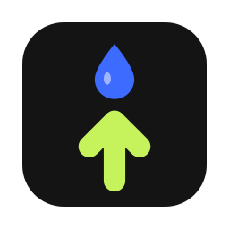
</p>

<h1 align="center">Stip</h1>

<p align="center"><strong>Stand. Sip. Ship.</strong><br>A small desktop app that gets you off your chair and drinking water, for people who forget to move.</p>

<p align="center"><a href="https://amreshvs.github.io/stip">amreshvs.github.io/stip</a>: try a break right in your browser</p>

<p align="center">
  <a href="https://github.com/AmreshVs/stip/actions/workflows/ci.yml"></a>
  <a href="LICENSE"></a>
  
</p>

<p align="center">
  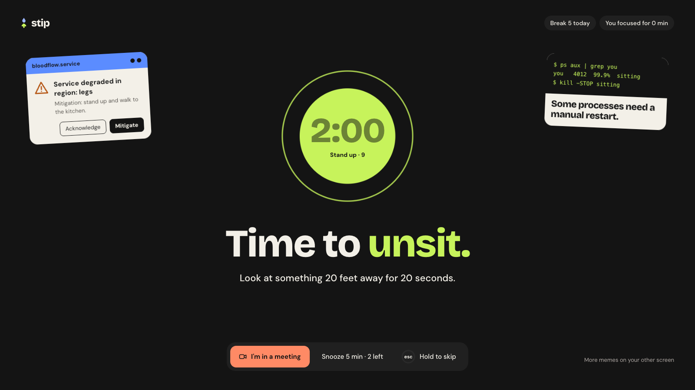
</p>

Every 30 minutes, Stip covers your screens with a calm two-minute stand break, with something simple to do: a stretch, a look out of the window, a glass of water. Every half hour, a water drop runs down the edge of your screen into a little orb that asks you to take a sip. It lives in your menu bar or system tray, stays out of your way during calls, and never sends your data anywhere.

## What it does

**Stand breaks that are hard to ignore.** A full-screen break covers every display: a breathing timer on your main screen, memes on the others. A soft chime tells you when you can sit back down.

**A way out when you need one.** "I'm in a meeting" waits until your call ends. "Snooze 5 min" works twice in a row, then it's time to stand. Skipping takes a 3-second hold of Esc, so you can't dismiss it by reflex. Pick how strict it should be: gentle, balanced or strict.

**Calls are safe.** Turn on meeting mode from the tray and the break waits. Zoom calls are detected automatically. The break starts 30 seconds after the call ends.

**A water reminder you'll actually notice.** The screen dims a little, a drop falls into an orb in the corner, and the water level shows how much you've had today. One click logs a glass, and clicks pass straight through to your apps everywhere else.

**Fair timing.** Three minutes away from the keyboard counts as a break, and the timer restarts after your computer sleeps or locks. Set working days and hours, or pause for 30 minutes, an hour or the rest of the day.

**Your week at a glance.** A Stats page shows your stand streak, breaks by hour, and water over the last seven days.

**Waits for a natural pause.** If you're busy or a build is running, the break starts when you pause, 10 minutes later at most. It only looks at idle time and program names, never what you type.

**Pick your water character.** A rubber duck that floats up as you drink, a CPU that cools down, a camel, a goldfish, a cactus or a plant. Or keep the orb. They earn things as you go: a hat for the duck, a heatsink for the chip, a second hump for the camel.

**The Spine report.** Your week as a code review: "changes requested", with a diff of your habits and a suggestion you can apply. Save it as an image to share.

**A terminal command.** Install it from settings, then `stip status`, `stip pause 1h`, or `npm run build && stip break`.

**Two themes.** Flat is bold and solid. Aurora is a calm, glowing night.

## Screenshots

### Flat theme

| Tray | Water reminder |
| --- | --- |
| 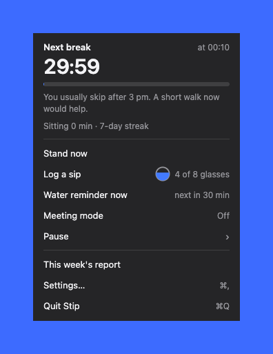 | 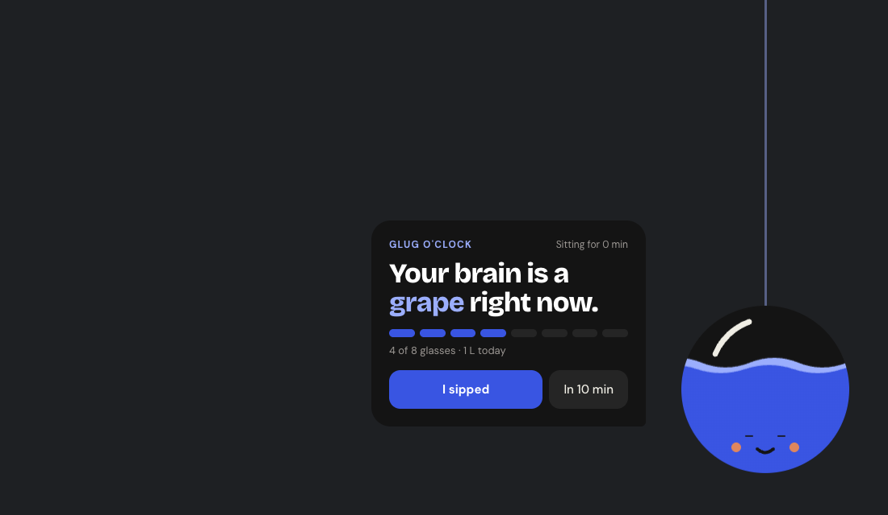 |

| Settings | Stats |
| --- | --- |
| 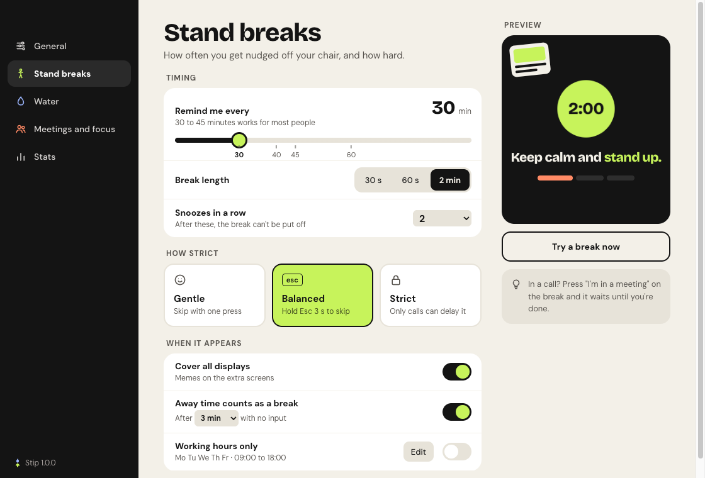 | 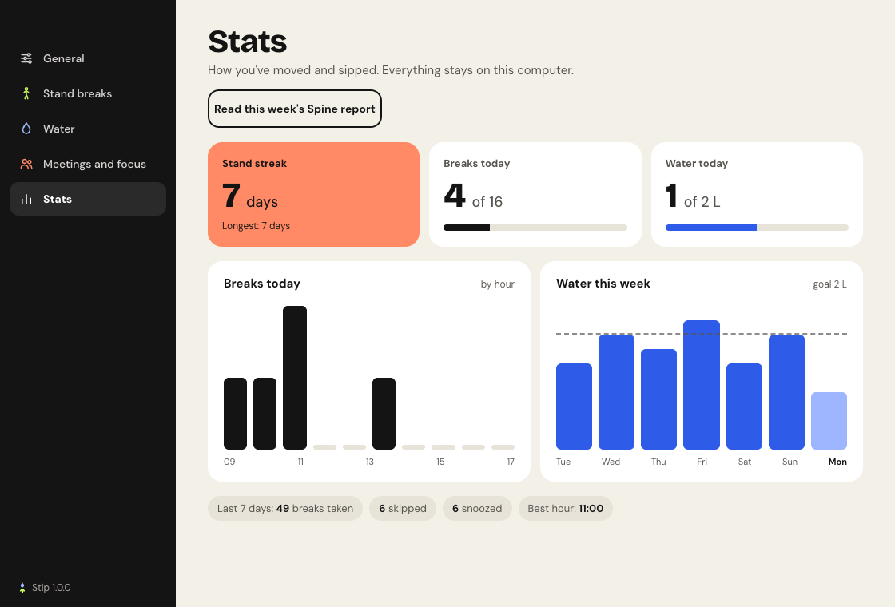 |

### Spine report

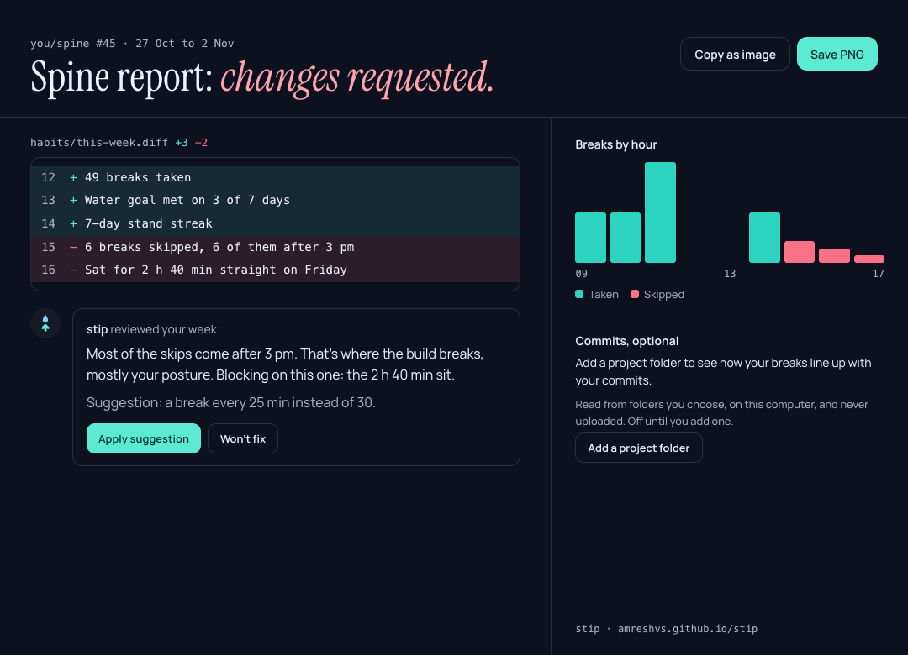

### Aurora theme

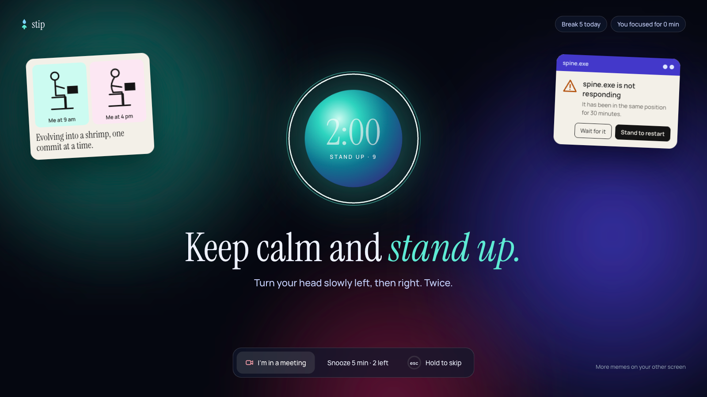

| Tray | Water reminder |
| --- | --- |
| 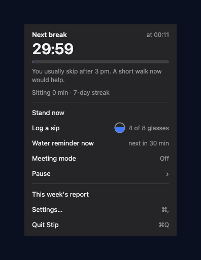 | 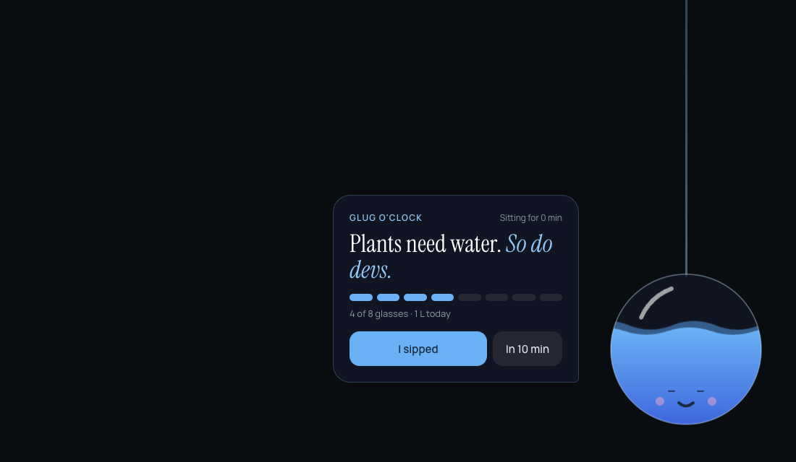 |

| Settings | Stats |
| --- | --- |
| 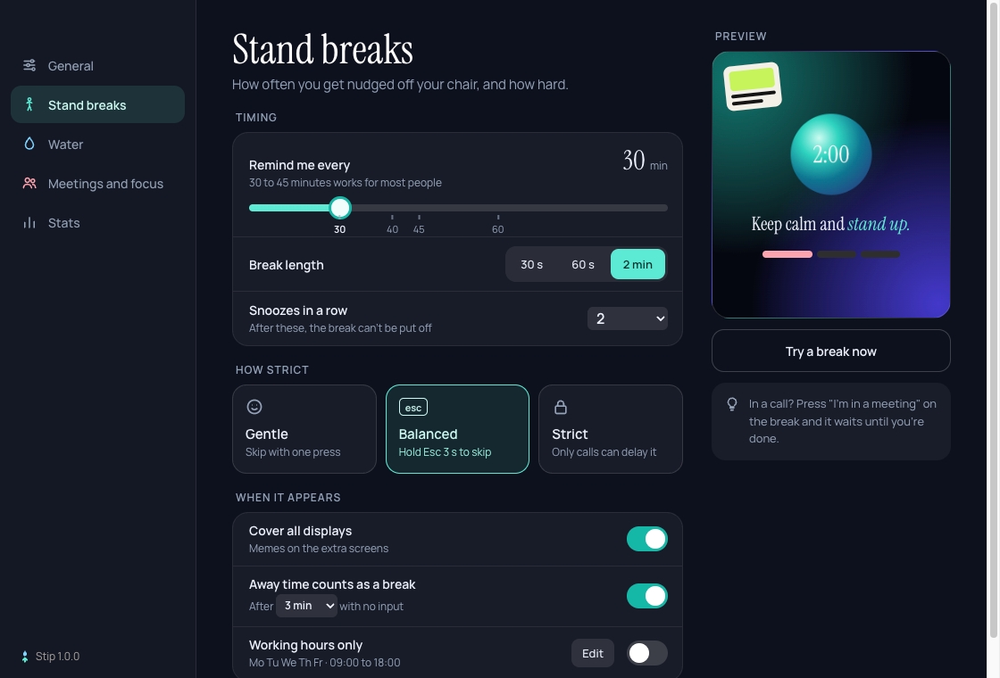 | 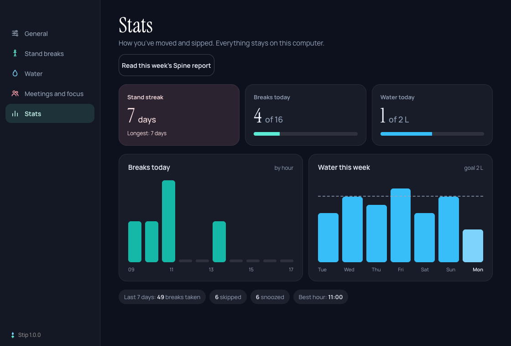 |

## Install

<a href="https://apps.microsoft.com/detail/9MSN24PF9CD5?mode=direct"></a>

On Windows, the easiest way is the [Microsoft Store](https://apps.microsoft.com/detail/9MSN24PF9CD5). The Store version installs without any warning and updates itself.

For macOS and Linux, or the Windows installer, download the latest version from the [releases page](https://github.com/AmreshVs/stip/releases/latest):

- **macOS:** the `.dmg`, one universal build for Apple silicon and Intel Macs. Releases are signed and notarized by Apple. If a build ever says it can't be opened, open **System Settings → Privacy & Security** and choose **Open Anyway**, or run `xattr -cr /Applications/Stip.app`.
- **Linux:** the `.AppImage` (make it executable, then run it) or the `.deb` for Debian and Ubuntu.
- **Windows:** the [Microsoft Store](https://apps.microsoft.com/detail/9MSN24PF9CD5), or the `.exe` installer. The installer isn't code-signed yet, so the first time Windows SmartScreen says "Windows protected your PC": choose **More info**, then **Run anyway**.

## Built with Tauri

Stip is built with [Tauri](https://tauri.app/): a small Rust core with the screens drawn in the system's own web view, so the download is small and the app stays light. The app lives in `src-tauri/`. Its pages are the ones in `src/renderer/`, which `src-tauri/build.rs` copies in at build time so Tauri can embed them. [src-tauri/README.md](src-tauri/README.md) explains how the app is put together.

To run it from source, install [Rust](https://www.rust-lang.org/tools/install), [Tauri's prerequisites](https://tauri.app/start/prerequisites/) for your platform and Node.js 20 or newer (for the fonts the pages use), then:

```bash
git clone https://github.com/AmreshVs/stip.git
cd stip
npm install               # once, for the fonts
cd src-tauri
cargo run                 # the app, in the menu bar or system tray
```

Dev runs should keep their data apart from your real settings: `STIP_USER_DATA=/tmp/stip-dev cargo run`.

To build an installer yourself, from `src-tauri/`:

```bash
npx @tauri-apps/cli@2.12.4 build --bundles app,dmg            # macOS
npx @tauri-apps/cli@2.12.4 build --bundles appimage,deb       # Linux
npx @tauri-apps/cli@2.12.4 build --bundles nsis               # Windows
```

They land in `src-tauri/target/release/bundle/`. Build each platform on that platform.

## Releases

Releases are built and published by GitHub Actions. Before a release, list the changes under **Unreleased** in `CHANGELOG.md`. Then open **Actions → Release → Run workflow** and pick:

- **Bump the version:** `patch`, `minor` or `major`. CI updates `package.json` and `CHANGELOG.md` and commits that to `main`. Pick `none` to release the version that's already there.
- **Build for macOS / Linux / Windows:** untick the platforms you don't need. A release carries only the platforms that were built, so leave all three ticked for a normal release.
- **Tag this version and publish a GitHub release:** tick it to tag the version and publish a release with the DMG, AppImage, .deb and Windows installer, using that version's changelog notes as the release text. Leave it unticked to only build the installers, which you can download from the run's page.

Pushing a tag such as `v1.0.0` from your machine also builds and publishes a release. To bump locally instead of in CI, run `npm run bump -- patch` (or `minor`, `major`, or an exact version).

### Microsoft Store

The Windows build in the release workflow also packs the app into `Stip-<version>-x64.msix`, which stays on the run's page under Artifacts. To make it yourself, run `npm run dist:store` on Windows after building the app. Upload it in Partner Center as a new submission; the Store signs it, so Store installs show no warning. Stip's Store page is [apps.microsoft.com/detail/9MSN24PF9CD5](https://apps.microsoft.com/detail/9MSN24PF9CD5), and every GitHub release links to it. The package identity is set under `msix` in `package.json`, and the tile images are made by `npm run icons`.

### Mac App Store

`npm run dist:mas` builds the sandboxed Mac App Store version (the `mas` cargo feature, which leaves out call detection, build spotting, git and the `stip` command) and signs it into `dist/Stip-<version>-universal.pkg` for Transporter. It needs the store's provisioning profile at `build/Stip_App_Store.provisionprofile` and the Mac App Store distribution and installer certificates in your keychain; [scripts/mas.js](scripts/mas.js) lists the details.

### Signing and notarizing for macOS

The workflow signs the Mac app with a Developer ID certificate and notarizes it with Apple when these repository secrets exist (Settings → Secrets and variables → Actions). Without them, it falls back to an ad-hoc signature.

| Secret | What it is |
| --- | --- |
| `CSC_LINK` | Your **Developer ID Application** certificate and private key, exported from Keychain Access as a `.p12`, then base64-encoded: `base64 -i stip.p12 \| pbcopy` |
| `CSC_KEY_PASSWORD` | The password you set when exporting the `.p12` |
| `APPLE_ID` | The Apple ID email of your developer account |
| `APPLE_APP_SPECIFIC_PASSWORD` | An app-specific password from [account.apple.com](https://account.apple.com) → Sign-In and Security |
| `APPLE_TEAM_ID` | Your 10-character Team ID, shown in brackets in the certificate's name |

You can add each one from the terminal; `gh` asks for the value so it never lands in your shell history:

```bash
gh secret set CSC_LINK
```

You need Rust, Tauri's prerequisites and Node.js 20 or newer.

## Using Stip

- **Tray:** click the Stip icon in the menu bar or system tray for the countdown, today's water, and the Stand now, Water now and meeting mode buttons. On macOS the countdown also shows right in the menu bar.
- **During a break:** stand, stretch and breathe with the orb. If you can't right now, use "I'm in a meeting", "Snooze 5 min", or hold Esc for 3 seconds to skip.
- **Water:** tap "I sipped" when you drink, or "In 10 min" to be asked again later. The orb waits a minute, and stays put while your pointer is on it.
- **Settings:** open them from the tray to change the timing, strictness, water goal, working hours and theme.

## Privacy

Stip makes no network requests and has no analytics. Settings and stats are JSON files in the app's data folder on your computer. To notice Zoom calls, it checks the names of running processes every 15 seconds and keeps nothing.

## Known limits

- Calls are detected for Zoom only. For other apps, turn on meeting mode from the tray.
- Linux can't pass clicks through a window, so there the water reminder stays in the bottom corner and doesn't dim the screen.
- Packaged builds aren't signed for every platform yet, so your OS may warn you the first time you open one.

## Develop

```bash
cd src-tauri
cargo run                 # run the app
cargo test                # unit tests for the timing rules, stats and report
STIP_PROBE=1 cargo run    # self-check: opens every window, checks it, prints a JSON report
cargo run -- --show=tray  # open one screen at once: break, water, tray, settings, report
```

From the repository root:

```bash
npm start                     # the app (cargo run in src-tauri/); add -- --show=tray etc.
npm test                      # unit tests for the stip command and the characters
npm run screenshots           # refresh the screenshots in docs/ (runs the app; macOS)
npm run screenshots:appstore  # the Mac App Store screenshots in build/app-store/
npm run icons                 # render the icon PNGs from the SVGs in assets/
npm run dmg-background        # render build/dmg-background.html (needs Chrome)
npm run site                  # preview the landing page at http://localhost:4173
```

The [contributing guide](CONTRIBUTING.md) explains fast test timings, previewing any screen with `--show`, and how the code is laid out.

```
src-tauri/         The app: Rust core in src/, Tauri config, icons
src/renderer/      One folder per window: break, water, tray, settings, report
src/cli.js         The stip command's client, also run by the tests
tauri-proto/       The first prototype of the hard window parts
assets/            Icon sources and generated PNGs
docs/              The landing page, served by GitHub Pages
scripts/           Screenshots, icons, store packages, version bumps
test/              Unit tests
```

## Contributing

Bug reports, ideas and pull requests are welcome. Please read the [contributing guide](CONTRIBUTING.md) and the [code of conduct](CODE_OF_CONDUCT.md) first. To report a security problem, see [SECURITY.md](SECURITY.md).

## Credits

- Built with [Tauri](https://tauri.app/).
- Fonts: [Bricolage Grotesque](https://fonts.google.com/specimen/Bricolage+Grotesque), [DM Sans](https://fonts.google.com/specimen/DM+Sans), [Instrument Serif](https://fonts.google.com/specimen/Instrument+Serif) and [Manrope](https://fonts.google.com/specimen/Manrope), all under the SIL Open Font License, bundled through [Fontsource](https://fontsource.org/).
- Every picture in Stip is drawn in code for it, and no images are borrowed. The jokes are a mix of Stip's own and classic programming one-liners.

## License

[MIT](LICENSE) © Amresh Vs

Made with Claude
