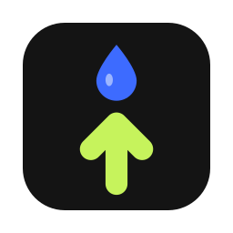
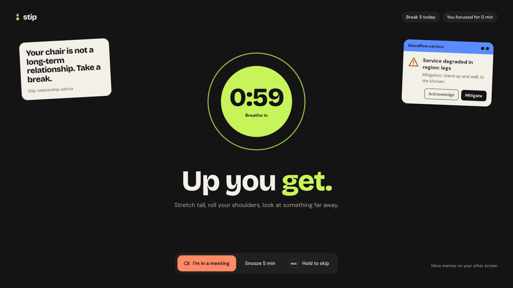
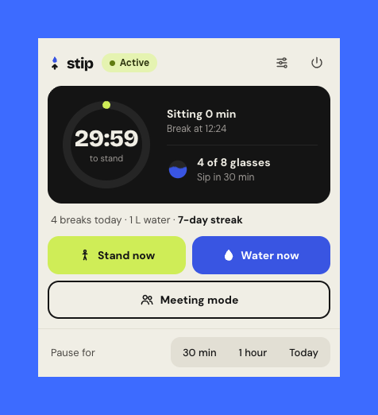
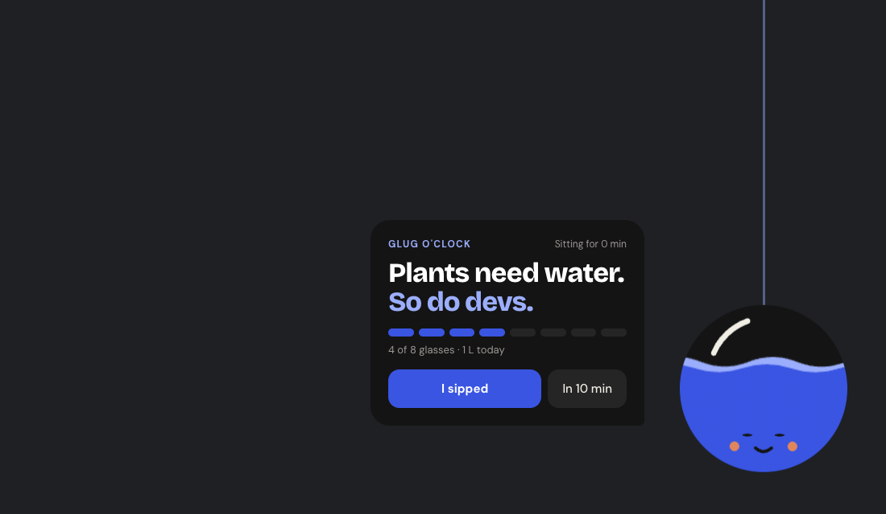
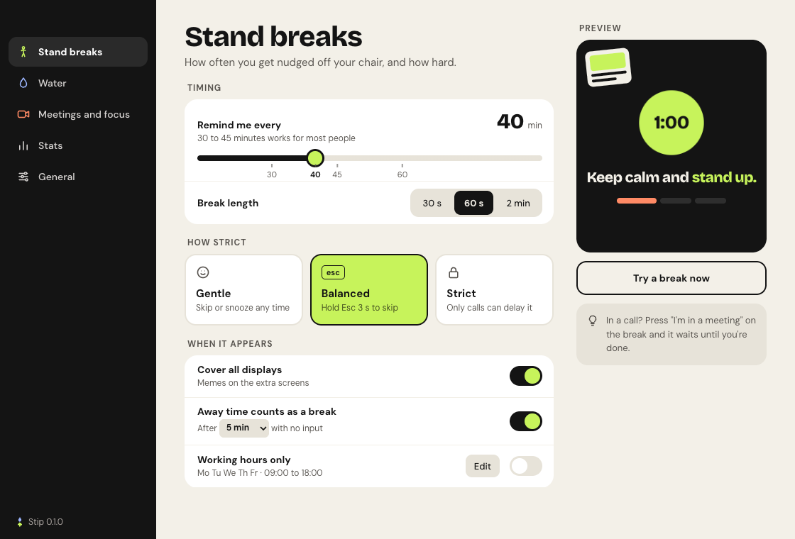
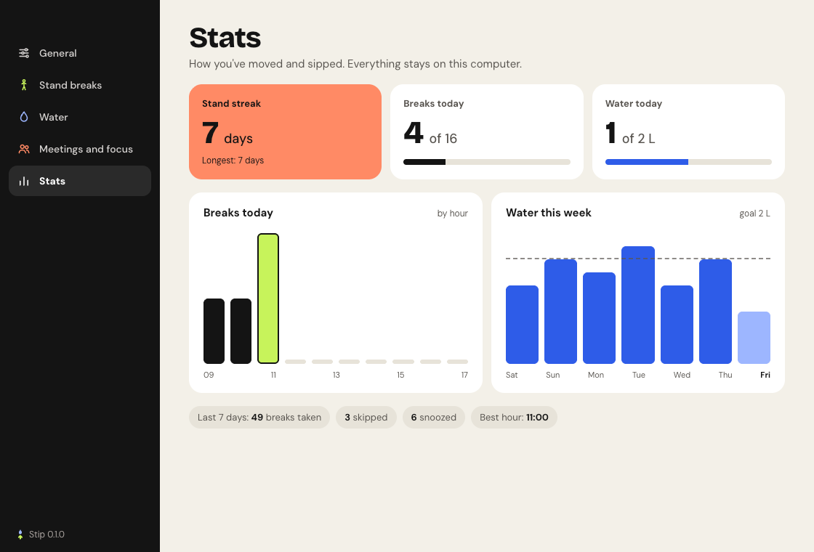
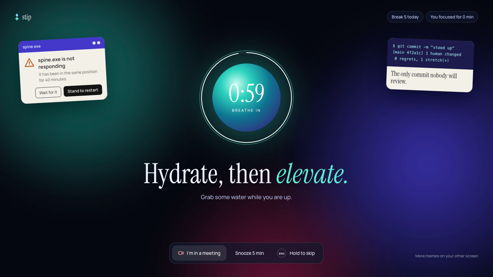
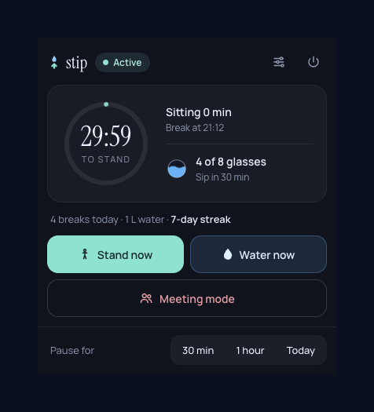
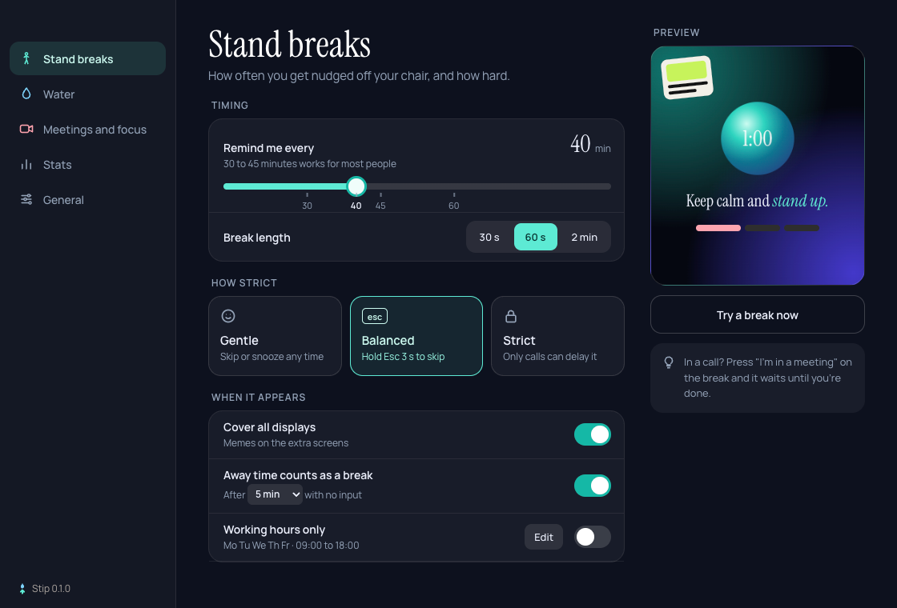

<p align="center">
  
</p>

<h1 align="center">Stip</h1>

<p align="center"><strong>Stand. Sip. Ship.</strong><br>A small desktop app that gets you off your chair and drinking water, for people who forget to move.</p>

<p align="center"><a href="https://amreshvs.github.io/stip">amreshvs.github.io/stip</a>: try a break right in your browser</p>

<p align="center">
  <a href="https://github.com/AmreshVs/stip/actions/workflows/ci.yml"></a>
  <a href="LICENSE"></a>
  
</p>

<p align="center">
  
</p>

Every 30 minutes, Stip covers your screens with a calm two-minute stand break, with something simple to do: a stretch, a look out of the window, a glass of water. Every half hour, a water drop runs down the edge of your screen into a little orb that asks you to take a sip. It lives in your menu bar or system tray, stays out of your way during calls, and never sends your data anywhere.

## What it does

**Stand breaks that are hard to ignore.** A full-screen break covers every display: a breathing timer on your main screen, memes on the others. A soft chime tells you when you can sit back down.

**A way out when you need one.** "I'm in a meeting" waits until your call ends. "Snooze 5 min" works twice in a row, then it's time to stand. Skipping takes a 3-second hold of Esc, so you can't dismiss it by reflex. Pick how strict it should be: gentle, balanced or strict.

**Calls are safe.** Turn on meeting mode from the tray and the break waits. Zoom calls are detected automatically. The break starts 30 seconds after the call ends.

**A water reminder you'll actually notice.** The screen dims a little, a drop falls into an orb in the corner, and the water level shows how much you've had today. One click logs a glass, and clicks pass straight through to your apps everywhere else.

**Fair timing.** Three minutes away from the keyboard counts as a break, and the timer restarts after your computer sleeps or locks. Set working days and hours, or pause for 30 minutes, an hour or the rest of the day.

**Your week at a glance.** A Stats page shows your stand streak, breaks by hour, and water over the last seven days.

**Two themes.** Flat is bold and solid. Aurora is a calm, glowing night.

## Screenshots

| Tray | Water reminder |
| --- | --- |
|  |  |

| Settings | Stats |
| --- | --- |
|  |  |

<details>
<summary>Aurora theme</summary>







</details>

## Install

Download the latest version from the [releases page](https://github.com/AmreshVs/stip/releases/latest):

- **macOS:** the `.dmg` (`arm64` for Apple silicon, `x64` for Intel Macs). The app isn't notarized by Apple yet, so the first time, right-click Stip in Applications and choose **Open**.
- **Linux:** the `.AppImage` (make it executable, then run it) or the `.deb` for Debian and Ubuntu.
- **Windows:** build it from source for now.

To run it from source instead:

```bash
git clone https://github.com/AmreshVs/stip.git
cd stip
npm install
npm start
```

To build an installer yourself:

```bash
npm run dist:mac      # DMG, on macOS
npm run dist:linux    # AppImage and .deb, on Linux
npm run dist          # whatever fits the platform you're on
```

They land in `dist/`. Build each platform on that platform.

## Releases

Releases are built by GitHub Actions. Bump `version` in `package.json`, add the changes to `CHANGELOG.md`, then tag and push:

```bash
git tag v1.0.0
git push origin v1.0.0
```

The workflow builds the DMG, AppImage and .deb and attaches them to a new GitHub release. You can also run it by hand from the Actions tab to build them without releasing.

You need Node.js 20 or newer.

## Using Stip

- **Tray:** click the Stip icon in the menu bar or system tray for the countdown, today's water, and the Stand now, Water now and meeting mode buttons. On macOS the countdown also shows right in the menu bar.
- **During a break:** stand, stretch and breathe with the orb. If you can't right now, use "I'm in a meeting", "Snooze 5 min", or hold Esc for 3 seconds to skip.
- **Water:** tap "I sipped" when you drink, or "In 10 min" to be asked again later. The orb waits a minute, and stays put while your pointer is on it.
- **Settings:** open them from the tray to change the timing, strictness, water goal, working hours and theme.

## Privacy

Stip makes no network requests and has no analytics. Settings and stats are JSON files in the app's data folder on your computer. To notice Zoom calls, it checks the names of running processes every 15 seconds and keeps nothing.

## Known limits

- Calls are detected for Zoom only. For other apps, turn on meeting mode from the tray.
- Linux can't pass clicks through a window, so there the water reminder stays in the bottom corner and doesn't dim the screen.
- Packaged builds aren't signed for every platform yet, so your OS may warn you the first time you open one.

## Develop

```bash
npm start                 # run the app
npm test                  # unit tests for the timing rules and stats
npm run e2e               # end-to-end test: drives the real app with hidden windows
npm run screenshots       # refresh the screenshots in docs/
npm run icons             # render the icon PNGs from the SVGs in assets/
npm run site              # preview the landing page at http://localhost:4173
```

The [contributing guide](CONTRIBUTING.md) explains fast test timings, previewing any screen with `--show`, and how the code is laid out.

```
src/main/          Electron main process: scheduler, stats, tray and windows
src/renderer/      One folder per window: break, water, tray, settings
src/preload.js     The small API the windows use to talk to the main process
assets/            Icon sources and generated PNGs
docs/              The landing page, served by GitHub Pages
e2e/               End-to-end test
test/              Unit tests
```

## Contributing

Bug reports, ideas and pull requests are welcome. Please read the [contributing guide](CONTRIBUTING.md) and the [code of conduct](CODE_OF_CONDUCT.md) first. To report a security problem, see [SECURITY.md](SECURITY.md).

## Credits

- Built with [Electron](https://www.electronjs.org/).
- Fonts: [Bricolage Grotesque](https://fonts.google.com/specimen/Bricolage+Grotesque), [DM Sans](https://fonts.google.com/specimen/DM+Sans), [Instrument Serif](https://fonts.google.com/specimen/Instrument+Serif) and [Manrope](https://fonts.google.com/specimen/Manrope), all under the SIL Open Font License, bundled through [Fontsource](https://fontsource.org/).
- Every picture in Stip is drawn in code for it, and no images are borrowed. The jokes are a mix of Stip's own and classic programming one-liners.

## License

[MIT](LICENSE) © Amresh Vs

Made with Claude
